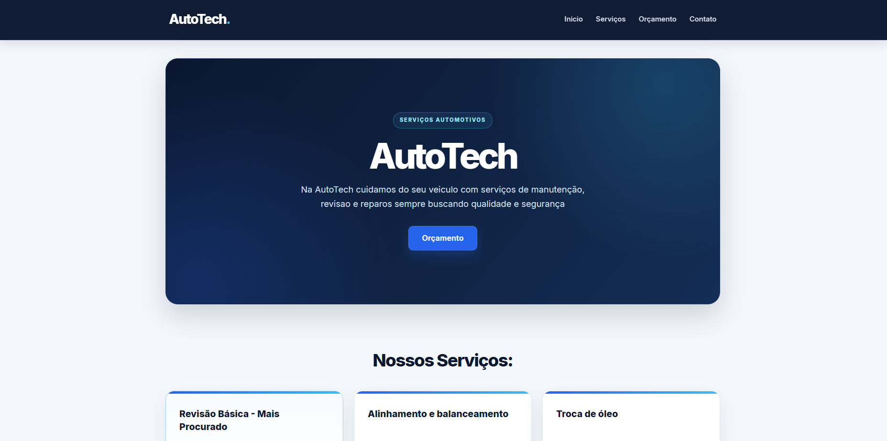
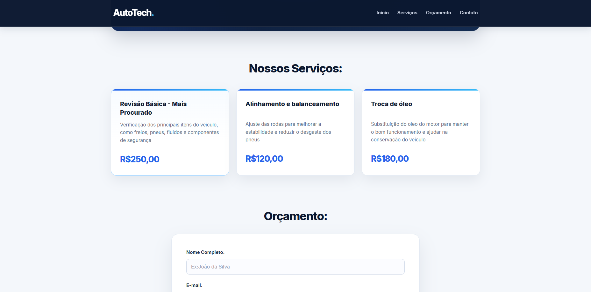
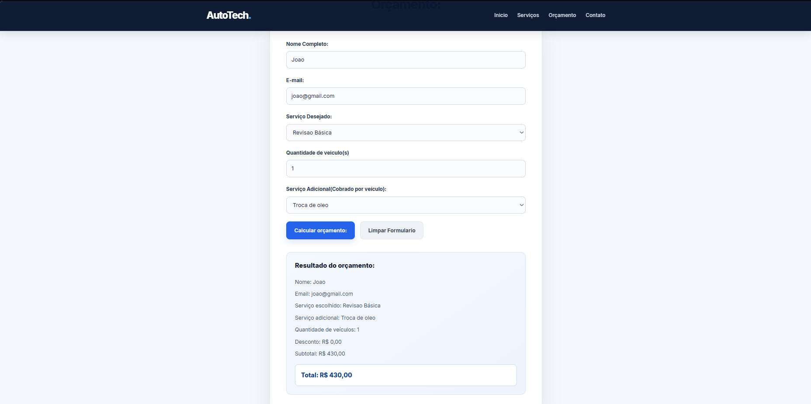
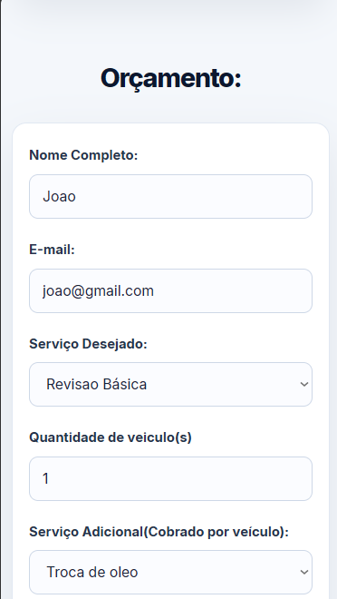

# AutoTech — Simulador de Orçamentos Automotivos

> Projeto demonstrativo desenvolvido com HTML, CSS e JavaScript para simular orçamentos de serviços automotivos. **A AutoTech é uma empresa fictícia; os serviços, preços e contatos apresentados são ilustrativos.**

## Sobre o projeto

O AutoTech é uma página responsiva que apresenta serviços automotivos e permite calcular um orçamento estimado com base no serviço escolhido, na quantidade de veículos e em um serviço adicional opcional.

O projeto foi desenvolvido como atividade de estudos e aprimorado para demonstrar habilidades de desenvolvimento front-end, validação de formulários e manipulação do DOM.

## Funcionalidades

- Apresentação de serviços e preços ilustrativos.
- Formulário com nome, e-mail, serviço principal, quantidade de veículos e serviço adicional opcional.
- Cálculo do subtotal, considerando a quantidade de veículos e o adicional por veículo.
- Aplicação de **10% de desconto** quando o subtotal é **maior ou igual a R$ 500,00**.
- Bloqueio da seleção do mesmo serviço como principal e adicional, com mensagem de orientação.
- Resultado detalhado com valores formatados em reais (`pt-BR`).
- Botão para limpar o formulário e restaurar a mensagem inicial.
- Interface adaptada para telas maiores e dispositivos móveis.

## Tecnologias

- **HTML5:** estrutura semântica e formulário.
- **CSS3:** estilos, layout responsivo e estados visuais.
- **JavaScript:** regras de cálculo, validação e atualização dinâmica dos resultados.

## Capturas de tela

### Página inicial



### Serviços



### Orçamento calculado



### Visualização em dispositivos móveis

| Página inicial | Formulário |
| :---: | :---: |
|  |  |

## Como executar localmente

1. Baixe o repositório ou clone-o com o Git.
2. Mantenha as pastas `css/` e `js/` ao lado do arquivo `index.html`, conforme a estrutura do projeto.
3. Abra `index.html` em um navegador moderno. Você também pode utilizar a extensão **Live Server** do VS Code.
4. Selecione os serviços e a quantidade de veículos, preencha os campos obrigatórios e clique em **Calcular orçamento**.

Não é necessário instalar dependências, configurar banco de dados ou iniciar um servidor backend.

## Estrutura do projeto

```text
.
├── index.html
├── css/
│   └── style.css
├── js/
│   └── script.js
├── screenshots/
│   ├── inicio.png
│   ├── servicos.png
│   ├── orcamento.png
│   ├── mobile-inicio.png
│   └── mobile-orcamento.png
└── README.md
```

## Demonstração online

🚀 [Acessar o AutoTech](https://arielgcoleto.github.io/AutoTech/)

## Observação

Este projeto simula um orçamento **estimado** para fins educacionais e de portfólio. Ele não realiza agendamentos, pagamentos, armazenamento dos dados em banco de dados ou envio automático de mensagens/PDF pelo WhatsApp.
